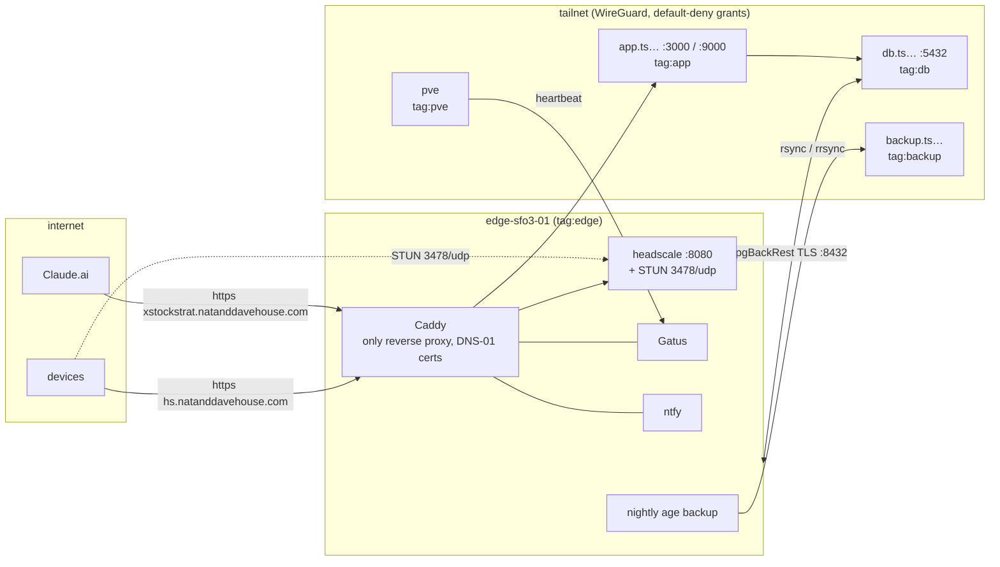

# homelab edge (DigitalOcean control node)

Self-hosted [headscale](https://github.com/juanfont/headscale) control plane, embedded DERP/STUN relay, and the only
public entry point into a homelab behind CGNAT. Everything is Ansible, run from GitHub Actions; secrets are SOPS.

Public exposure is exactly **80/tcp, 443/tcp, 3478/udp** (DO Cloud Firewall). SSH is reachable only over the tailnet
(`tag:deploy` runners and admin devices). On `xstockstrat.natanddavehouse.com` the internet gets only the MCP endpoint
and the OAuth login routes; tailnet clients get the whole app through the same name (split-horizon DNS).

## Repository map

| Path | What |
|---|---|
| `playbooks/provision.yml` | DO droplet, reserved IPv4, Cloud Firewall (API via `uri`) |
| `playbooks/bootstrap-users.yml` | first contact as root: admin + deploy users |
| `playbooks/site.yml` | everything on the host: hardening, Docker, stack, tailscale, alerts, backups, pgBackRest repo, deploy key |
| `playbooks/verify-tailnet.yml` | ephemeral `tag:ci` test node: join, list, extra-record DNS, removal when offline |
| `playbooks/backup-now.yml` | run backup + restore drill now |
| `playbooks/node-admin.yml` | list / approve / tag / force-reauth / remove devices, mint CI key; writes a run summary |
| `playbooks/diag-stun.yml` | read-only STUN evidence from both ends (run by verify) |
| `scripts/` | offline tests (`policy-test.sh`, `caddy-routing-test.sh`), `stun-probe.py`, `tls-check.py`, `runner-tailnet.sh`, `init_secrets.py` |
| `policy/policy.hujson` | headscale grants + `tests` (tests run in CI only; see `docs/decisions.md`) |
| `roles/stack/templates/` | `Caddyfile`, headscale `config.yaml`, ntfy `server.yml`, `compose.yml` |
| `inventories/prod/group_vars/all/` | `main.yml` (settings), `versions.yml` (every pin; rationale in `docs/versions.md`), `generated.yml` (reserved IP) |
| `secrets/` | SOPS files only (`secrets/README.md`) |
| `.github/workflows/` | `ci`, `deploy`, `verify`, `init-secrets`, `node-admin` |

## Rebuild from scratch

Everything below except steps 1, 4 and the device logins is a button in GitHub Actions; every workflow touching
the VPS waits for approval on the `production` environment.

1. **Keys** (once): five ed25519 keys — `sops_admin`, `backup`, `sops_deploy`, `id_ed25519_admin`, `id_ed25519_deploy`.
   Public halves go into `.sops.yaml` (`sops_admin`, `sops_deploy`), `group_vars/all/main.yml`
   (`admin_ssh_public_keys`, `deploy_ssh_public_key`, `backup_age_recipients`). Private halves: see `secrets/README.md`.
2. **GitHub → Settings → Environments → `production`**: required reviewer `davcs86`; secrets
   `DIGITALOCEAN_TOKEN` (custom scopes: droplet, firewall, reserved_ip, ssh_key, tag; read regions/sizes/images),
   `DEPLOY_SSH_KEY`, `SOPS_AGE_SSH_PRIVATE_KEY`.
   **Settings → Secrets and variables → Actions → Repository secrets**: `DIGITALOCEAN_READ_TOKEN`, a second DO token
   with the single custom scope `firewall:read`. The daily **verify** schedule uses it without the `production` gate.
3. **Actions → deploy → `provision`**. Creates the droplet and reserved IPv4 and commits `generated.yml`.
4. **DNS and tokens** (needs the reserved IP from `generated.yml`):
   - Cloudflare (`natanddavehouse.com`, all **DNS-only / grey cloud**):

     | Name | Type | Value |
     |---|---|---|
     | `hs` | A | reserved IPv4 |
     | `xstockstrat` | A | reserved IPv4 |
     | `_acme-challenge.hs` | CNAME | `hs.acme.natanddavehouse.com` |
     | `_acme-challenge.xstockstrat` | CNAME | `xstockstrat.acme.natanddavehouse.com` |
     | `_acme-challenge.ts` | CNAME | `ts.acme.natanddavehouse.com` (wildcard `*.ts…`) |

   - deSEC: create a token that can only write those three TXT RRsets, only from the droplet's egress addresses
     (see [`docs/runbooks/acme-token.md`](docs/runbooks/acme-token.md)). Store it as environment secret `DESEC_TOKEN`.
   - healthchecks.io: one check, period 5 min, grace 10 min, email to you; ping URL → secret `HC_PING_URL`.
   - Choose and store (≥ 16 chars, also in your password manager): `ADMIN_CONSOLE_PASSWORD`, `NTFY_DAVID_PASSWORD`.
5. **Actions → init-secrets**. Generates ntfy publisher credentials and the pgBackRest mTLS PKI, encrypts everything
   into `secrets/edge.sops.yaml`, commits it.
6. **Actions → deploy → `bootstrap`**. Opens 22/tcp to the runner's IP only, pins the host key in
   `inventories/prod/known_hosts`, configures everything, mints the `tag:deploy` key, then **closes 22/tcp and proves
   it from the runner** (also on failure). From here on use mode `tailnet`.
7. **Actions → verify**. External scan + HTTPS/routing/rate-limit checks, then the tailnet test node and a backup drill.
8. **Home side**: see [`docs/runbooks/home-side.md`](docs/runbooks/home-side.md).

Rebuilding onto a new droplet: delete the old droplet in DO, run `provision` (re-attaches the same reserved IP, so no
DNS change), delete the `edge-sfo3-01` line from `known_hosts`, replace the deSEC token (the new droplet has new
egress addresses, see [`docs/runbooks/acme-token.md`](docs/runbooks/acme-token.md)), run `bootstrap`, then
[restore headscale](docs/runbooks/recovery.md) so existing nodes keep working.

## Documentation

| Need | Read |
|---|---|
| Add, tag or revoke a device; CI pre-auth keys | [`docs/runbooks/tailnet-devices.md`](docs/runbooks/tailnet-devices.md) |
| Rotate the deSEC ACME token | [`docs/runbooks/acme-token.md`](docs/runbooks/acme-token.md) |
| Restore headscale; break glass | [`docs/runbooks/recovery.md`](docs/runbooks/recovery.md) |
| Backup host, Proxmox, app VM, DB host | [`docs/runbooks/home-side.md`](docs/runbooks/home-side.md) |
| Every pinned version and why | [`docs/versions.md`](docs/versions.md) |
| Design decisions and traps already hit | [`docs/decisions.md`](docs/decisions.md) |
| Working rules for AI agents in this repo | [`CLAUDE.md`](CLAUDE.md) |
